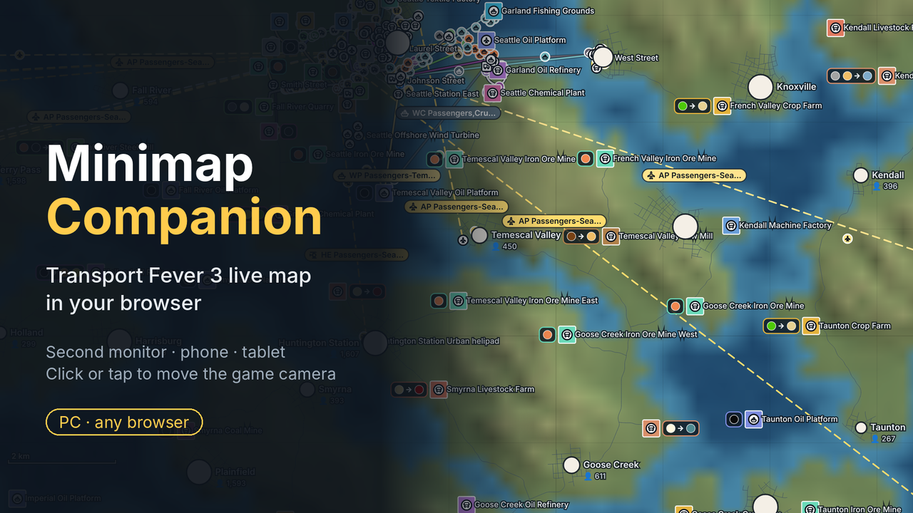

# TF3 Minimap — your Transport Fever 3 game as a live map in your browser

A live map of your Transport Fever 3 world in any web browser while you play — on a **second monitor**, a **phone** or a **tablet**. Nothing to install on the phone: it is a web page.



- **Live map**: terrain and water, roads and tracks, towns with population, industries with the cargo they accept and produce, every station and line along its real route, moving vehicles.
- **Tap or click for details**: what a line carries right now, load, interval; station catchment; industry production and deliveries.
- **Drive the game camera**: tap or click a place to jump there, a vehicle to follow it.
- **Filters**: transport types, passengers / cargo, industry types, layers. Rotate the map to any angle, km or miles, export the network as SVG.
- **13 languages**, the same as the game.

PC only (Windows, Mac, Linux / Steam Deck). It does **not** work on consoles: the companion app has to run on the computer next to the game.

## How it works

```
Transport Fever 3 ── mod writes map data ──▶ game save folder ──▶ companion app ──▶ browser: 2nd monitor / phone / tablet
                 ◀── camera commands ───────────────────────────────┘
```

The mod (Lua, runs inside the game) exports the map into the game's save folder and reads camera commands.
The companion (Python, no extra packages) serves the page on this computer and to your local network. Nothing goes to the internet.

## Install

1. **Mod**: subscribe to [**Minimap Companion** on mod.io](https://mod.io/g/transportfever3/m/minimap-companion) (in the game: Mods) and enable it when you load your save.
   Manual install: unzip `tf3_minimap-mod-manual-install.zip` into `<Steam>/userdata/<your id>/3493540/local/mods/`.
2. **Companion**: download from [Releases](../../releases/latest):
   - Windows: `TF3-Minimap-Windows.zip` — unzip, double-click `TF3 Minimap.exe` (no Python needed).
     First start: "Windows protected your PC" → *More info* → *Run anyway*; allow *Private networks* in the firewall prompt.
   - Mac / Linux / Steam Deck: `TF3-Minimap-Mac-Linux.zip` — unzip, start `Start Minimap (Mac).command` (right-click → Open the first time) or `start-minimap-linux.sh`. Needs Python 3.
3. Open the address the companion shows in a browser:
   - second monitor of the same computer: `http://localhost:8765`
   - phone or tablet in the same Wi-Fi: the `http://192.168.x.x:8765` address it lists.

Phone does not connect? Same network (not a guest Wi-Fi, no VPN on the phone), firewall allows the app, try every address listed.

### Options

```
--port 9000          another port (default 8765)
--bind 127.0.0.1     only this computer, not the network
--userdata PATH      game save folder if not found: <Steam>/userdata/<id>/3493540/local
--game PATH          game install folder, for cargo icons
```

Anyone in the same Wi-Fi who knows the address can see the map and move the camera; use `--bind 127.0.0.1` if that matters.

## For developers

- `mod/tf3_minimap/` — the mod as uploaded to mod.io. `_metadata/mod.io_fileid.txt` links it to the mod.io page — keep it.
  To publish an update: copy the folder into `<Steam>/userdata/<id>/3493540/local/staging_area/`, raise `revision` in `mod.json`, restart the game, *Mod Manager → My Mods*, and upload only if it says *"The existing mod on mod.io will be updated."*
- `companion/` — `tf3map_server.py` (web server), `tf3map_probe.py` (file channel, Lua data reader, command line probe), `web/` (the page).
- `test/` — runs the real mod Lua against a fake game API (`pip install lupa`): `python3 test/fake_game.py <folder>`, then `python3 companion/tf3map_server.py --userdata <folder>`.
- Releases: set `VERSION` in `companion/tf3map_server.py`, push to the `release` branch (or run the *release* workflow by hand); GitHub Actions builds the Windows program and the zips and publishes release `v<VERSION>`.

## Русский

Живая карта игры Transport Fever 3 в обычном браузере — на втором мониторе, телефоне или планшете (на телефон ничего ставить не нужно, это веб-страница): рельеф, дороги и пути, города, производства с иконками грузов, станции и линии по реальным маршрутам, движущийся транспорт. Нажатие показывает подробности и переносит камеру игры. Фильтры, поворот карты, км/мили, экспорт схемы в SVG, 13 языков.

Только ПК (Windows, Mac, Linux / Steam Deck); на консолях не работает.

**Установка**
1. Подпишитесь на мод [**Minimap Companion** на mod.io](https://mod.io/g/transportfever3/m/minimap-companion) (в игре: Моды) и включите его при загрузке сохранения.
2. Скачайте компаньон в [Releases](../../releases/latest): Windows — `TF3-Minimap-Windows.zip`, запуск `TF3 Minimap.exe` (Python не нужен; при первом запуске «Подробнее → Выполнить в любом случае» и разрешить «Частные сети» в брандмауэре). Mac/Linux — `TF3-Minimap-Mac-Linux.zip`, нужен Python 3.
3. Откройте в браузере адрес из окна компаньона: на втором мониторе того же компьютера — `http://localhost:8765`, на телефоне или планшете в той же Wi-Fi сети — адрес `http://192.168.x.x:8765`.

## License

MIT — see [LICENSE](LICENSE). Transport Fever 3 is a trademark of its owners; this is an unofficial fan project.
